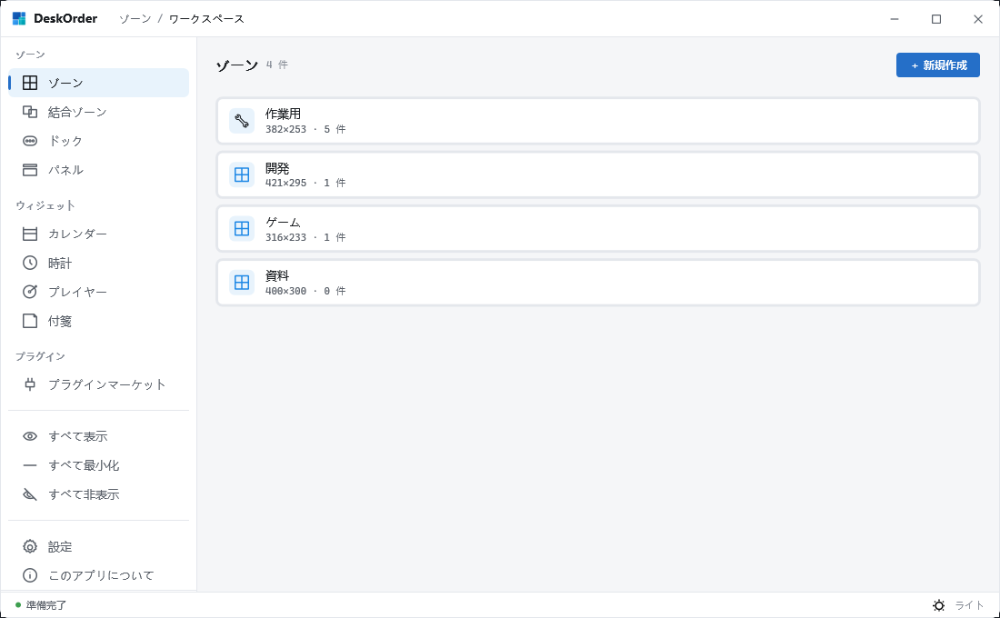
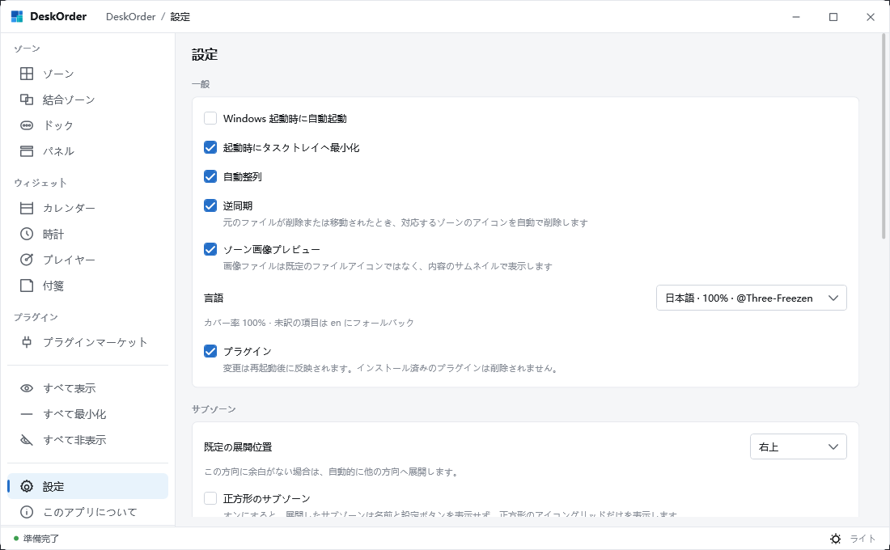
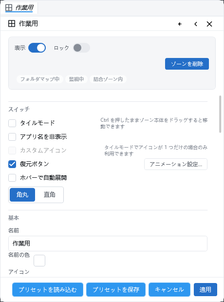
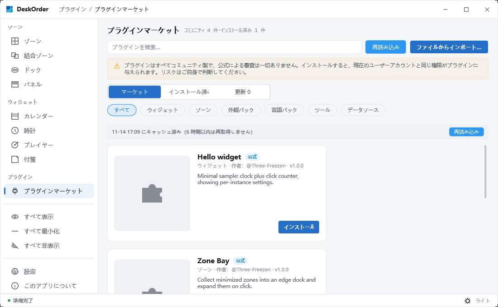

# DeskOrder 日本語パック / DeskOrder Japanese Language Pack

DeskOrder の UI を**日本語に完全翻訳**する公式の言語パックです。純データ（宣言型）で、コードは一切実行しません。

| | |
|---|---|
| 言語 | 日本語（`ja`） |
| カバー率 | **967 / 967 語（100%）** — 英語へのフォールバックなし |
| 対応 DeskOrder | 1.0.27 以降 |
| パッケージ | `lang-ja-full-1.0.0.dopkg`（署名付き） |
| ライセンス | Apache-2.0 |

## スクリーンショット









## インストール

1. DeskOrder を起動し、サイドバーの **「プラグイン」→「プラグインマーケット」** を開く
2. 「日本語（全量翻译）」を **インストール**
3. **設定 → 言語** で **日本語** を選ぶ
4. すぐに切り替わります（再起動は不要）

手動で入れる場合は、リリースページの `lang-ja-full-1.0.0.dopkg` を
**プラグイン → ファイルからインポート…** で読み込んでください。

## 翻訳方針

- **文体**：ボタン・ラベル・メニューは体言止め（「保存」「削除」）、説明文・通知・確認はです・ます調。
- **表記**：半角英数字の前後は半角スペース（`DeskOrder を起動`、`{0} 件`）、括弧は全角、引用は「」。
- **用語**（意図的に統一しています）:

  | 英語 / 中国語 | 日本語 |
  |---|---|
  | zone / 分区 | ゾーン |
  | sub-zone / 次级分区 | サブゾーン |
  | merged zone / 组合分区 | 結合ゾーン |
  | panel / 面板 | パネル |
  | Zone Bay / 分区坞 | ゾーンベイ |
  | dock / 快捷栏 | ドック |
  | widget / 组件 | ウィジェット |
  | plugin / 插件 | プラグイン |
  | plugin marketplace / 插件市场 | プラグインマーケット |
  | appearance pack / 外观包 | 外観パック |
  | language pack / 语言包 | 言語パック |
  | preset / 预设 | プリセット |
  | material / 材质 | マテリアル |
  | liquid glass / 液态玻璃 | リキッドグラス |
  | sticky note / 便签 | 付箋 |
  | blocklist / 禁用名单 | ブロックリスト |
  | coverage / 覆盖率 | カバー率 |
  | fallback / 回退 | フォールバック |

- プレースホルダー `{0}` などの書式指定子は原文と完全に一致させています（全角化しません）。
- `DeskOrder`、`GitHub`、`Windows`、`SHA-256`、`minisign`、`.dopkg`、`%APPDATA%` などの固有名詞・技術名は翻訳しません。

## 既知の制限

- 日付の書式（パネルの日付）は OS の地域設定に従います。日本語版 Windows なら「2026年11月14日（土曜日）」、
  それ以外の地域では曜日名だけがその言語で出ます（ホスト側の仕様で、言語パックからは変更できません）。
- マーケットのカードに表示されるプラグイン名・説明は、レジストリの仕様上 `zh` / `en` の 2 言語のみです。

## 翻訳の改善提案

誤訳・不自然な表現を見つけたら [Issues](https://github.com/Three-Freezen/DeskOrder-Plugin-Japanese/issues) か PR でお知らせください。
`i18n/ja.json` はキーがホストの `i18n/source.zh.json` と 1:1 で対応するフラット JSON です。
キーの追加・削除はできません（未知のキーはインストール時に拒否されます）。

```powershell
# 検証（DeskOrder のソースツリーがある場合）
python plugin-community\tools\validate_language.py `
    DeskOrder-Plugin-Japanese\i18n\ja.json `
    --source DeskOrder\i18n\source.zh.json `
    --manifest DeskOrder-Plugin-Japanese\manifest\plugin.json
```

## ビルド

`.dopkg` は次のスクリプトで再生成できます（署名鍵はリポジトリに含まれません）:

```powershell
powershell -NoProfile -ExecutionPolicy Bypass -File plugin-community\tools\build-ja-pack.ps1
```

---

## English

The official Japanese language pack for [DeskOrder](https://github.com/Three-Freezen/DeskOrder) — a desktop
icon organizer and beautifier for Windows. It is a declarative pack (no code is executed) and translates
**all 967 host strings (100% coverage)** with consistent terminology and natural Japanese UI phrasing.

Install it from **Plugins → Marketplace**, then pick **日本語** under **Settings → Language**.

Found a mistranslation? Please open an issue or a pull request against `i18n/ja.json`.

Licensed under the Apache License 2.0. The UI strings themselves are derived from DeskOrder, also Apache-2.0.
